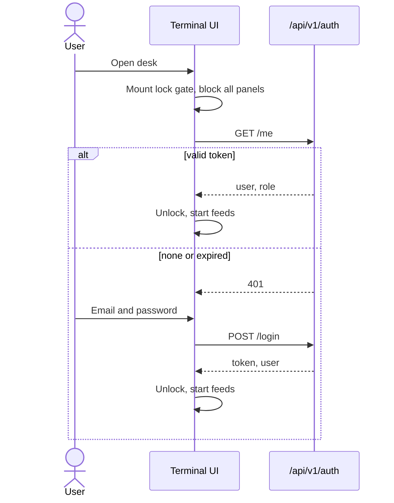

# BTC Volatility Desk: Master Implementation Plan (v2)

v2 covers every numbered item from the requirements list (5 to 29). Items 1 to 4, 8 and 9 were not in the list provided, so they are marked as pending in Section 14.

Items that are new or changed from v1 are tagged **[NEW]** or **[CHANGED]**.

---

## 0. Decisions Needed Before Build

| # | Question | Default used in this plan |
|---|---|---|
| D1 | One Delta account or two (read-only key and trade key)? | **Config switch.** Single-account mode: one key set, arm/disarm only gates order dispatch. Dual-account mode: two streams in parallel. |
| D2 | Session boundaries for Usual IV Fall (NY overlaps Asia in v1) | Non-overlapping 24h grid, see Section 9. |
| D3 | Voice: is a cloud-assisted `hi-IN` recognizer acceptable? | Yes for v1, with a note in the UI. Fully offline STT is a later option. |
| D4 | Retention of tick-by-tick read-only P&L | 30 days raw, then 1-minute downsampled. |

---

## 1. Goal

Turn the BTC Volatility Desk into a secure 24x7 multi-instrument (BTC, ETH, AXUSD) volatility options terminal with:

1. Zero-trust terminal entry lock (item 29)
2. Hindi (Devanagari) voice assistant (item 28)
3. Owner user tracker, feedback box, owner-approved password reset (item 29)
4. Parallel read and trade streaming plus a master Arm/Disarm switch (items 10, 15)
5. 24x7 hourly shadow strangle engine as the FX-tab leading indicator (item 17)
6. Greek P&L bifurcation and tick-by-tick read-only P&L recording (items 5, 6) **[NEW detail for 5]**
7. Correct bot net P&L and an audited P&L analysis section (items 7, 23) **[NEW]**
8. Stale-read diagnosis (item 10) **[NEW]**
9. Strangle suitability score for "is today good for a short strangle" (item 12) **[NEW]**
10. Accurate Usual IV Fall and "why is IV not falling" diagnostics (items 14, 16, 21) **[NEW]**
11. Strict 0.10 to 0.15 delta enforcement in live, bot and paper (items 19, 20) **[CHANGED]**
12. Full 24x7 de-restriction across news, flow, clock, ATM IV and best indicator (items 21, 22, 24) **[NEW detail]**
13. Collateral alarm, theme sync, full-screen alerts, Ask Me timer (items 18, 25, 26, 27)

---

## 2. Architecture Overview

```mermaid
flowchart TD
    subgraph Gate [Layer 0: Security Gate]
        Lock["Terminal Entry Lock (#vTerminalLockGate)"]
    end

    subgraph UI [Layer 1: Browser Workstation]
        Header["Header: BTC/ETH/AXUSD, Arm Switch, Voice, Theme"]
        Streams["Read stream + Trade stream (single or dual account)"]
        Pnl["Floating P&L (Greek split) + Stale-read badge"]
        Gauge["Go Gauge (live position delta, gamma, IV)"]
        FX["FX Tab: Hourly Strangle Leading Indicator"]
        Suit["Strangle Suitability Score"]
        IVW["IV Waiting-For panel"]
        PA["P&L Analysis (fills-based, reconciled)"]
        Tracker["Owner Tracker + Feedback"]
    end

    subgraph API [Layer 2: Fastify Backend]
        Auth["/auth"]
        Admin["/admin/users"]
        Fb["/feedback"]
        Relay["/delta/signed"]
        Mkt["/mkt"]
        PnlSvc["P&L Recorder + Reconciler"]
        Shadow["Shadow Strangle Engine"]
        IVSvc["IV Stats Service (usual fall, waiting-for)"]
        Bot["Bot Engine (strict strike picker)"]
        DB[(Postgres: users, desk_password_resets, desk_feedback, shadow_cohorts, shadow_candles, pnl_ticks, fills, iv_snapshots, bot_runs)]
    end

    subgraph DX [Layer 3: Delta Exchange India]
        Acc["Read account / Trade account"]
        Data["Market data and options chain"]
    end

    Lock --> Header
    Streams <--> Relay <--> Acc
    Mkt <--> Data
    Mkt --> Shadow --> FX
    Mkt --> IVSvc --> IVW
    Relay --> PnlSvc --> PA
    PnlSvc --> DB
    Shadow --> DB
    IVSvc --> DB
    Bot --> DB
```



---

## 3. Terminal Entry Lock (Item 29)

- Full-screen gate `#vTerminalLockGate` (`z-index: 999999`, blur, opaque dark) mounts before any panel or request.
- No market, chart or position request fires until `GET /api/v1/auth/me` returns a valid user.
- Login form: user ID or email, password, remember-me (encrypted session token), request password reset, clear errors (invalid credentials, rate-limit cooldown).
- Auto-lock after 30 minutes of inactivity (configurable) or token expiry. "Lock Terminal" button in the user chip.
- Server-side rate limiting and lockout on repeated failures. Passwords hashed (argon2 or bcrypt). Reset tokens single-use.



---

## 4. Owner User Tracker, Feedback, Password Reset (Item 29)

### Schema (single naming: `desk_` prefix everywhere) **[CHANGED]**

```sql
ALTER TABLE users ADD COLUMN IF NOT EXISTS active_mode varchar(20) DEFAULT 'read_only';
ALTER TABLE users ADD COLUMN IF NOT EXISTS last_seen_at timestamptz DEFAULT now();
ALTER TABLE users ADD COLUMN IF NOT EXISTS can_trade boolean DEFAULT false;

CREATE TABLE IF NOT EXISTS desk_password_resets (
  id uuid PRIMARY KEY DEFAULT gen_random_uuid(),
  user_id uuid REFERENCES users(id) ON DELETE CASCADE,
  status varchar(30) NOT NULL DEFAULT 'pending_owner_approval', -- approved | rejected | used | expired
  requested_at timestamptz NOT NULL DEFAULT now(),
  decided_at timestamptz,
  decided_by uuid REFERENCES users(id),
  token_hash text,
  expires_at timestamptz
);

CREATE TABLE IF NOT EXISTS desk_feedback (
  id uuid PRIMARY KEY DEFAULT gen_random_uuid(),
  user_id uuid REFERENCES users(id) ON DELETE CASCADE,
  user_email text NOT NULL,
  category varchar(50) NOT NULL DEFAULT 'observation',
  title text,
  description text NOT NULL,
  created_at timestamptz NOT NULL DEFAULT now(),
  status varchar(20) NOT NULL DEFAULT 'open' -- open | archived
);
```

### Admin audit log **[NEW]**

Every owner action on another user's account (kill switch, force READ ONLY, reset approval or rejection) writes one row. Rows are insert-only (no update or delete from the app).

```sql
CREATE TABLE IF NOT EXISTS desk_admin_audit (
  id uuid PRIMARY KEY DEFAULT gen_random_uuid(),
  ts timestamptz NOT NULL DEFAULT now(),
  actor_id uuid NOT NULL REFERENCES users(id),
  target_user_id uuid REFERENCES users(id),
  action varchar(40) NOT NULL,        -- kill_switch | force_read_only | reset_approve | reset_reject | feedback_archive
  target_ref text,                    -- symbol, order id or reset id
  request jsonb,                      -- what was asked (no secrets, no API keys)
  result varchar(20) NOT NULL,        -- ok | failed | denied
  result_detail text,
  ip inet
);
CREATE INDEX IF NOT EXISTS idx_admin_audit_ts ON desk_admin_audit (ts DESC);
CREATE INDEX IF NOT EXISTS idx_admin_audit_target ON desk_admin_audit (target_user_id, ts DESC);
```

The tracker has an "Audit" tab showing this table for the owner.

### Owner tracker panel `#pgUserTracker` (admin only)

- Live table: user, online dot (seen in last 60 s), active mode pill, Read key / Trade key badges, open positions with strikes, lots, unrealized P&L.
- Drill-down into a user's open legs.
- Emergency kill switch: owner can close or cancel a user's position. Every action is written to an audit log (who, what, when, result).
- Owner can force any user into READ ONLY.
- Password reset: request creates a `pending_owner_approval` row, owner sees a banner with Approve and Reject. The user cannot reset until approved. Approved link expires (suggest 30 minutes) and is single-use.

### Feedback

- Users: modal with category, title and multiline description.
- Owner: chronological list and a **Clean / Archive** button with a confirmation step. Archive by default, hard delete as a second option.

---

## 5. Streaming, Arm/Disarm, Stale-Read Fix (Items 10, 15)

### Streaming

- **Dual-account mode (D1):** Loop A `kind=read` and Loop B `kind=trade` poll in parallel (positions every 2 s, fills every 5 s). Neither is paused by the arm state.
- **Single-account mode:** one loop with one key set. The Arm switch only gates order dispatch.

### Master Arm/Disarm switch

- `READ ONLY` (green): all feeds at full rate. Ask Me and bot execution buttons are interlocked.
- `READ + TRADE` (pulsing amber): order dispatch unlocked.
- Workflow: arm, place order via Ask Me, disarm, later arm again to exit.
- Safety additions **[NEW]**: optional auto-disarm after N seconds of inactivity and after each completed order, with a setting to turn that off. Arm state is enforced server-side (backend rejects trade-kind order calls when disarmed), not only by greying out buttons.

### Stale read delta warning (Item 10) **[NEW]**

Problem: "no fresh read delta" appears on the floating P&L for the read-only account.

Plan:
1. Show age of the last good read next to the P&L (`updated 3s ago`). Warn only when age exceeds a threshold (suggest 3 x poll interval, so 6 s for positions).
2. Add a heartbeat per loop with a reason code shown on hover:
   - tab hidden and timer throttled by the browser
   - HTTP 429 or rate limit
   - 401 or 403 (key permission or IP whitelist)
   - HMAC timestamp skew (signature rejected)
   - network error or timeout
   - positions returned but greeks missing for that symbol (ticker fetch failed)
3. Compute position delta from the option ticker greeks, falling back to a Black-Scholes delta from mark IV if the ticker greeks are missing, and label it `calc`.
4. Use `setTimeout` chained after each response (not `setInterval`) to avoid piling up requests, and use `visibilitychange` to resume immediately.
5. Add an automated test that simulates a missing ticker and checks the warning text and fallback.

---

## 6. P&L: Greek Split, Tick Recording, Net P&L, Analysis (Items 5, 6, 7, 23)

### 6.1 Floating P&L with Greek split (Item 6)

Inside `#vUniversalFloatingPnl`:

ΔPnL = Delta term + Gamma term + Theta term + Vega term + Residual

- Delta + Gamma (price move), Theta (time), Vega (IV change), Spread/Other (residual so the parts always sum to the total).
- Expandable card, shows dollars per component and per leg.
- Attribution is computed between consecutive ticks and accumulated since entry.

### 6.2 Read-only P&L tick by tick (Item 5) **[NEW]**

- **Recorder runs on the backend**, so ticks are stored even when the browser is closed. The frontend only displays.
- Table:

```sql
CREATE TABLE IF NOT EXISTS pnl_ticks (
  ts timestamptz NOT NULL,
  account_kind varchar(10) NOT NULL,        -- read | trade | paper
  position_key text NOT NULL,               -- symbol or strangle id
  spot numeric, mark numeric, iv numeric,
  upnl numeric, rpnl numeric,
  delta_pnl numeric, gamma_pnl numeric, theta_pnl numeric, vega_pnl numeric, other_pnl numeric,
  pos_delta numeric, pos_gamma numeric, pos_vega numeric, pos_theta numeric,
  PRIMARY KEY (account_kind, position_key, ts)
);
```

- Granularity follows the poll (about 2 s). Retention per D4: 30 days raw, then 1-minute rollups kept indefinitely.
- P&L Analysis section gets a "Read-only account ticks" view: time-scrubbable chart, component stack, drawdown, max adverse excursion per trade.
- Batch inserts (flush every few seconds) to keep the database light.

### 6.3 Bot trading net P&L fix (Item 7) **[NEW]**

Likely causes to verify against real data first: using mark price instead of fill price, missing exit fee, missing GST on fees, double counting realized plus unrealized, partial fills.

Definition to implement:

```
gross_pnl = sum over legs of (entry_avg_fill - exit_avg_fill) * qty * contract_value   # short legs
fees      = sum of fee fields from fills (entry + exit), including taxes on fees
net_pnl   = gross_pnl - fees
```

- Source of truth is the exchange fills (`/fills`), not marks.
- Store `entry_fee`, `exit_fee`, `fee_tax` on each `bot_runs` row.
- Reconciliation job: sum of net P&L over a day vs the change in wallet balance (minus deposits and funding). A mismatch above a small tolerance raises a flag in the UI.
- Unit tests: single full fill, partial fills, stop-loss exit, expiry settlement, fees on both sides.

### 6.4 P&L Analysis misleading data (Item 23) **[NEW]**

Audit first, then fix. Checklist:

1. Paper, live-read and live-trade rows mixed in one total. Fix: filter by source, default to one.
2. Realized and unrealized counted twice for positions closed during the period.
3. Missing fees (gross shown as net).
4. Timezone and day-boundary errors (use IST consistently, with a clear day cutoff setting).
5. Positions still open included in win-rate.
6. Currency mix (USD vs INR) without a label.
7. Rows logged outside the 0.10 to 0.15 delta rule (Item 19) polluting stats.

Output: every number on the page shows its source (fills or marks), account, and period. A small "Reconciled" badge appears when it matches the exchange ledger, "Unverified" otherwise.

### 6.5 Fills and bot run schemas **[NEW]**

```sql
-- Exchange fills: the source of truth for gross P&L and fees
CREATE TABLE IF NOT EXISTS fills (
  id uuid PRIMARY KEY DEFAULT gen_random_uuid(),
  exchange_fill_id text NOT NULL,
  exchange_order_id text,
  account_kind varchar(10) NOT NULL,         -- read | trade | paper
  user_id uuid REFERENCES users(id),
  instrument varchar(10) NOT NULL,
  symbol text NOT NULL,
  side varchar(4) NOT NULL,                  -- buy | sell
  qty numeric NOT NULL,
  price numeric NOT NULL,
  fee numeric NOT NULL DEFAULT 0,
  fee_tax numeric NOT NULL DEFAULT 0,        -- GST or other tax on fee
  fee_currency varchar(10),
  liquidity varchar(10),                     -- maker | taker
  bot_run_id uuid,                           -- links to bot_runs when placed by the bot
  filled_at timestamptz NOT NULL,
  raw jsonb,                                 -- original exchange payload for audits
  UNIQUE (account_kind, exchange_fill_id)    -- makes re-polling idempotent
);
CREATE INDEX IF NOT EXISTS idx_fills_filled_at ON fills (account_kind, filled_at);
CREATE INDEX IF NOT EXISTS idx_fills_bot_run ON fills (bot_run_id);

-- Net P&L columns on existing bot_runs (item 7)
ALTER TABLE bot_runs ADD COLUMN IF NOT EXISTS entry_fee numeric DEFAULT 0;
ALTER TABLE bot_runs ADD COLUMN IF NOT EXISTS exit_fee numeric DEFAULT 0;
ALTER TABLE bot_runs ADD COLUMN IF NOT EXISTS fee_tax numeric DEFAULT 0;
ALTER TABLE bot_runs ADD COLUMN IF NOT EXISTS gross_pnl numeric;
ALTER TABLE bot_runs ADD COLUMN IF NOT EXISTS net_pnl numeric;
ALTER TABLE bot_runs ADD COLUMN IF NOT EXISTS pnl_source varchar(10) DEFAULT 'fills'; -- fills | marks
ALTER TABLE bot_runs ADD COLUMN IF NOT EXISTS reconciled boolean DEFAULT false;
ALTER TABLE bot_runs ADD COLUMN IF NOT EXISTS reconciled_at timestamptz;
```

Notes:
- The fills poller upserts on `(account_kind, exchange_fill_id)`, so repeated polls never double count.
- `bot_runs.net_pnl` is computed only from `fills` rows linked by `bot_run_id`. Existing rows keep `pnl_source = 'marks'` until backfilled, and the P&L Analysis page shows them as "Unverified".
- Rows rejected by the 0.10 to 0.15 delta rule (Section 7) are never inserted here.

---

## 7. Strict 0.10 to 0.15 Delta Enforcement (Items 19, 20)

Applies to **live Ask Me, the bot, and the paper-trading path** **[CHANGED]**.

- Remove `belowTolerance` and `aboveTolerance` in `backend/src/lib/bot/strike-picker.ts` and `askTrade` in `frontend/index.html`.
- A single shared function `pickStrangleStrikes()` is used by live, bot and paper, so rules cannot drift.
- If no listed strike for a leg satisfies delta in [0.10, 0.15], **deny the order and write no log row** (also no row in `bot_runs` or paper history). Show a transient message "No strike in 0.10 to 0.15 delta" in the UI only.
- Delta source: exchange ticker delta at order time, re-checked immediately before dispatch.
- Backend enforces this too. A request that bypasses the UI is rejected with HTTP 422.
- Tests: boundary values 0.0999, 0.10, 0.15, 0.1501, and the missing-quote case.

---

## 8. Hourly Shadow Strangle Engine and FX-Tab Leading Indicator (Items 16, 17)

### 8.1 Cohorts

- Every hour on the hour (00:00 to 23:00 IST) the backend opens a virtual 100-lot short strangle at the nearest available call and put in [0.10, 0.15] delta.
- Each cohort is observed for its life and compared with the previous 2 cohorts (H-1, H-2) so persistent struggles on one leg are marked.

### 8.2 No strike in the delta band **[NEW detail]**

Fallback ladder:
1. Use the nearest listed strike inside [0.10, 0.15].
2. If none, synthesize strikes at 0.125 delta with Black-Scholes using the surface IV (interpolated between the nearest listed strikes) and price them from the interpolated IV. Mark the cohort `synthetic`.
3. If surface IV cannot be built (stale or empty book), skip the hour and record a gap. Do not fabricate data. The chart shows a gap marker.

Synthetic strike formula: with z = Φ⁻¹(0.125) ≈ -1.1503, put and call strikes follow from the usual BS delta inversion using ATM IV (skew-adjusted where available).

These synthetic cohorts are used only in the indicator, never for real order selection.

### 8.3 Per 15-minute candle metrics

- Per-leg P&L change and cumulative decay (call vs put).
- Delta drift per leg: dΔ/dt ≈ Γ · ΔS/Δt.
- IV change per leg: dIV/dt, and IV crush speed.
- Asymmetry index: |Decay_call - Decay_put| / initial premium.
- Theta captured vs theta expected.

### 8.4 Premium split: Gamma risk vs IV risk

For each cohort show how much of the premium is "paying for gamma" vs "paying for IV":
- Gamma risk share: expected loss from a typical move over the horizon (0.5 · Γ · (expected move)²) as a fraction of premium.
- IV share: Vega x (IV minus the usual IV for this session half) as a fraction of premium.
- Low IV entries are flagged as "small move can hit stop". High IV entries are flagged as "crush potential".

### 8.5 Visual indicator

- Top band "DO NOT TRADE / VOLATILE" (red), bottom band "TRADE ZONE / CALMED" (green).
- Two lines: Call decay path (cyan) and Put decay path (orange).
- Risk split bar and a top-right confidence meter (0 to 100).
- Past days load from the database so the chart is continuous across days.

### 8.6 Live position overlay **[NEW]**

When a real position exists (from the read or trade stream), plot its live path on the same chart in a distinct line and compare against the cohort that started closest to the entry time. Shows "your entry was early / late relative to the hourly cohorts".

### 8.7 Auto-learning confidence score

Phase 1 (rules): score from calm signals (both legs decaying, IV falling, delta drift small, asymmetry low).
Phase 2 (learning): after enough cohorts (suggest 200+), fit a simple model (logistic regression on features above) to predict "cohort ended profitable without hitting stop". Show the score and top 3 reasons. Re-train nightly. The UI shows sample size so a low-data score is visibly marked as low confidence.

### 8.8 Storage **[NEW]**

```sql
CREATE TABLE IF NOT EXISTS shadow_cohorts (
  id uuid PRIMARY KEY DEFAULT gen_random_uuid(),
  instrument varchar(10) NOT NULL,
  started_at timestamptz NOT NULL,
  call_symbol text, put_symbol text,
  call_delta numeric, put_delta numeric,
  call_entry numeric, put_entry numeric,
  is_synthetic boolean DEFAULT false,
  ended_at timestamptz, outcome varchar(20),
  UNIQUE (instrument, started_at)
);

CREATE TABLE IF NOT EXISTS shadow_candles (
  cohort_id uuid REFERENCES shadow_cohorts(id) ON DELETE CASCADE,
  ts timestamptz NOT NULL,
  call_mark numeric, put_mark numeric,
  call_delta numeric, put_delta numeric,
  call_iv numeric, put_iv numeric,
  spot numeric,
  call_pnl numeric, put_pnl numeric,
  PRIMARY KEY (cohort_id, ts)
);
```

### 8.9 Why IV does not fall (Item 16) **[NEW]**

A dedicated **IV Waiting-For** panel, shown in the FX tab and in the Go Gauge tooltip. For the current moment it evaluates and ranks possible reasons:

| Check | Signal |
|---|---|
| Realized vol vs IV | If RV (last 1h, 4h) is above IV, IV has no reason to fall |
| Upcoming events | US data, FOMC, options expiry times, ETF news, within the next N hours |
| Term structure | Front expiry IV above next (backwardation) means near-term event premium |
| Skew / demand | Put skew steepening means hedging demand is holding IV up |
| Bid/ask and book depth | Wide spreads can hold quoted IV up without trades |
| Open interest and funding | Rising OI with extreme funding means positioning risk |
| Session timing | Has this session-half historically seen IV fall by now? (from Section 9 stats) |
| Expiry proximity | Daily expiry roll changes which contract ATM IV refers to |

Output: "IV is holding because: 1) realized vol is 1.2x implied, 2) US CPI in 2h 10m". If none apply, it says "no identified reason, statistical expectation is a fall" and logs the case.

Separately a nightly job stores every hour where "IV did not fall when expected" and what happened next (fell later, spiked, drifted), so the answer to "who is IV waiting for in NY or Asia" becomes data rather than a guess.

---

## 9. Usual IV Fall, Sessions, and 24x7 De-restriction (Items 14, 21, 22, 24)

### 9.1 Session grid (Item 21) **[CHANGED]**

v1 gave NY unequal halves (4h and 8h) and an overlap with Asia from 05:30. Proposed non-overlapping grid covering 24h (IST):

| Session | Window | Half 1 | Half 2 |
|---|---|---|---|
| Asia | 05:30 to 12:30 | 05:30 to 09:00 | 09:00 to 12:30 |
| London | 12:30 to 19:30 | 12:30 to 16:00 | 16:00 to 19:30 |
| New York | 19:30 to 05:30 (next day) | 19:30 to 00:30 | 00:30 to 05:30 |

All windows are configurable. If you want a longer NY session, change the config and the halves recompute as equal splits automatically.

### 9.2 Making Usual Fall accurate (Item 14) **[NEW]**

Likely reasons it looks inaccurate: comparing IV of different expiries at different times (daily expiry roll), averaging across event days, using absolute IV points not relative change, tiny samples.

Method:
1. Store `iv_snapshots` every minute: constant-maturity ATM IV (for example fixed 1-day and 7-day interpolated) so the series does not jump at expiry roll.
2. For each session half and each past day, compute IV change start to end in percent of start IV.
3. Use the median and the 25th to 75th percentile band over the last N days (default 30), excluding days flagged as event days (CPI, FOMC and similar, configurable calendar).
4. Show sample size, the band, and today's live change against it. If sample size is below a minimum (for example 10), display "low data".
5. Backtest: for each past day compare predicted fall vs actual, report hit rate. Display this next to the number so the accuracy is visible.

```sql
CREATE TABLE IF NOT EXISTS iv_snapshots (
  ts timestamptz NOT NULL,
  instrument varchar(10) NOT NULL,
  atm_iv_1d numeric, atm_iv_7d numeric, spot numeric,
  rv_1h numeric, rv_4h numeric,
  PRIMARY KEY (instrument, ts)
);
```

### 9.3 24x7 de-restriction (Items 21, 22, 24) **[NEW detail]**

Remove every time lock and make each module session-aware:

| Module | Change |
|---|---|
| Strike picker lock (1:30 and 7:00) | Removed. Free for 24h. |
| Today's Off | Works for all 24h, not only NY. |
| News | Pull all sources, all sessions. Tag each item with session and expected impact (high, medium, low). |
| Chart news path | Plot all high-impact news from every session on the chart, not NY only. |
| ATM IV indicator | Runs for Asia, London and NY, with a per-session selector and an "All" view. |
| IV vs Clock | Remove fixed 21:00. Clicking the clock shows 24x7 data with session shading. |
| Flow panel | Session-wise 24x7 view (Asia, London, NY, All). |
| Best indicator | Computed for all 24h. Shows the best entry window per session. |
| Usual IV Fall | Per session, two halves, Section 9.1. |

A single `SESSIONS` config object is the source for all modules, so a future change happens in one place.

---

## 10. Strangle Suitability Score: "Is Today Good for a Short Strangle?" (Item 12) **[NEW]**

A 0 to 100 score with a verdict (GO / CAUTION / AVOID) and the reasons.

Inputs and weights (adjustable, start as suggested):

| Factor | What it measures | Weight |
|---|---|---|
| IV level vs recent | ATM IV percentile over 30 days | 20 |
| IV vs RV | Implied above realized is favorable (volatility risk premium) | 20 |
| Range so far vs expected | 24h range vs the range implied by IV | 15 |
| Trend strength | Trend indicator (such as ADX or EMA slope), low is favorable | 15 |
| Event risk | Time to next high-impact event | 15 |
| Shadow cohort results | Last few hourly cohorts calming or struggling | 10 |
| Skew / term structure | Extreme skew or backwardation penalized | 5 |

The score shows each factor's contribution, so the verdict can be audited. It feeds the Go Gauge and appears at the top of the FX tab. Weights can be tuned later from the auto-learning data in Section 8.7.

---

## 11. Go Gauge with Live Position Awareness (Item 13)

- Reads live position leg deltas, gamma and IV from the stream.
- Shows leg imbalance: net delta, which leg is heavy, and how fast imbalance is building.
- Fast-move protection: when spot moves sharply, the gauge marks the signal "unreliable, leg balance disturbed" instead of showing a false GO.
- Includes position gamma and IV beside the market indicators.

---

## 12. Multi-Instrument Switcher (Item 11)

- Header capsule `[ BTC | ETH | AXUSD ]`.
- Parameterizes tickers, option chains, candles, shadow strangles, IV snapshots, news filters and P&L views by instrument.
- Each instrument has its own config (contract value, strike step, delta band). Confirm the AXUSD symbol and chain availability on Delta before build (see risks).

---

## 13. Other Items

- **Insufficient collateral alarm (Item 18):** chime and top banner when available collateral is below required margin, in the live account only. Also checks before order dispatch.
- **Universal theme sync (Item 25):** one CSS variable theme set at the root, one toggle. Audit every isolated panel that has its own switch and remove it.
- **Full-screen alerts (Item 26):** flashing overlay on real algo entry and on real exit, with a dismiss button and sound (muted setting available).
- **Ask Me order progress (Item 27):** button locks instantly, shows `Please wait, placing order (0.8s)` with a live timer, then a tick on success or an error state. Also profile the slow path (sequential API calls, large chain fetch) and parallelize where possible.
- **Voice assistant (Item 28):**
  - Recognition `hi-IN` (fallback `en-IN`), synthesis via `speechSynthesis` with a Hindi voice.
  - Note for D3: in Chrome, `hi-IN` recognition is usually processed by the browser vendor's servers, so it is not fully offline and may add latency. Synthesis can be local if a Hindi voice is installed. The UI shows a one-line notice. A fully local engine can replace it later.
  - States: idle, listening, thinking, speaking, with a transcript HUD in Devanagari.
  - Reads desk state (active instrument, mode, positions, IV, gauge, hourly strangle) and answers from it.
  - Voice commands never place orders by themselves. "Exit position" only prepares the action and requires the Arm switch plus an on-screen confirm.

---

## 14. Items Not Provided

Items 1 to 4, 8 and 9 were not in the requirements list given for this plan. Add them here when available.

| Item | Status |
|---|---|
| 1 to 4 | Not provided |
| 8 | Not provided |
| 9 | Not provided |

---

## 15. Phased Waves

- **Wave 1: Security, tracker, voice:** items 28, 29
- **Wave 2: Streams, Arm switch, P&L foundation:** items 5, 6, 7, 10, 15, 23
- **Wave 3: Strict picker and order feedback:** items 18, 19, 20, 26, 27
- **Wave 4: Intelligence layer:** items 11, 12, 13, 14, 16, 17, 21, 22, 24, 25 (iv_snapshots and shadow engine start collecting here, so data begins building early)

Suggestion: start the `iv_snapshots` and `shadow_cohorts` collectors in Wave 2 even though their UI ships in Wave 4. The learning features and Usual Fall accuracy depend on how many days of history exist.

---

## 16. Verification Plan

### Automated

```powershell
npm --prefix backend run build
npm --prefix backend test
npm --prefix frontend run build
```

New tests:
- strike picker boundaries and no-log-on-deny (live, bot, paper)
- net P&L with fees, partial fills, stop exit
- P&L attribution components sum to total
- stale-read warning and fallback delta
- session grid halves and boundary times
- shadow cohort synthetic fallback and gap handling
- backend rejects trade orders while disarmed

### Manual

1. Terminal lock blocks everything in an incognito window.
2. Password reset stays pending until the owner approves.
3. Hindi voice answers "ट्रेड कैसे करें?" and refuses exit while disarmed.
4. Owner tracker shows users, modes, positions, kill switch writes an audit row.
5. DevTools shows read and trade polling running concurrently (dual mode).
6. Disarmed state blocks Ask Me dispatch, streams stay live.
7. Floating P&L parts sum to the total, ticks appear in P&L Analysis.
8. Net P&L of a closed bot trade matches the exchange fills and fees.
9. FX tab shows call and put paths, risk split, confidence, live position overlay.
10. IV Waiting-For panel gives reasons, Usual Fall shows band and sample size.
11. All modules show data at 03:00 IST, 10:00 IST and 15:00 IST (not only NY hours).

---

## 17. Risks and Open Checks

- Delta India API rate limits with two parallel loops plus a backend recorder. Measure before enabling dual mode by default.
- AXUSD option chain availability and symbols must be confirmed on Delta India.
- Owner kill switch writes on other users' accounts require those users' trade keys to be stored, which raises key-custody and consent requirements. Decide storage (encrypted at rest, per-user consent) before building.
- Synthetic cohorts must be clearly labelled so they are never mistaken for tradable quotes.
- Learning model needs enough history. Until then the confidence meter shows low-data state.
